# AI Portrait Generator – Frontend Application

Frontend of a web application for transforming portrait images into various artistic styles using an AI-based backend.

This project was developed as part of the module _Project KMI (Winter Semester 2024/25)_.

My main focus was the development of the frontend and the design of the user interface using Vue.js.

---

## My Role

- Proposed and implemented Vue.js 3, replacing the initial HTML/CSS/JavaScript approach
- Built the frontend using Vue 3 (Vite) with a component-based architecture
- Implemented routing and multi-page navigation
- Designed and developed the user interface (UI)
- Implemented the full user flow (Upload → Style Selection → Result Display)
- Integrated the frontend with the backend API
- Improved code structure, modularity, and maintainability
- The UI was refined through iterative design improvements based on usability considerations and feedback within the team

---

## Technologies

### Frontend

- Vue 3
- Vite
- Vue Router
- JavaScript
- HTML / CSS

### Backend (Integration)

- Python (Flask)

---

## Features

- Upload of portrait images via an intuitive drag & drop interface
- Selection of multiple artistic styles (e.g. Anime, Manga, Oil Painting, Watercolor)
- Real-time loading state during AI processing
- Display of generated results with download option
- Multi-page navigation (Home, Create, Gallery, About)
- Modular and reusable Vue components
- Responsive UI design

---

## User Flow

1. User opens the Home Page
2. Navigates to the Create Page
3. Uploads a portrait image
4. Selects an artistic style
5. Waits for AI processing (loading state)
6. Views and downloads the generated result

---

## Available Styles

The application allows users to choose between different artistic styles:

### Realistic

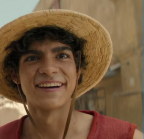

### Anime

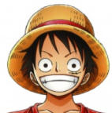

### Manga

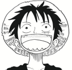

### Oil Painting

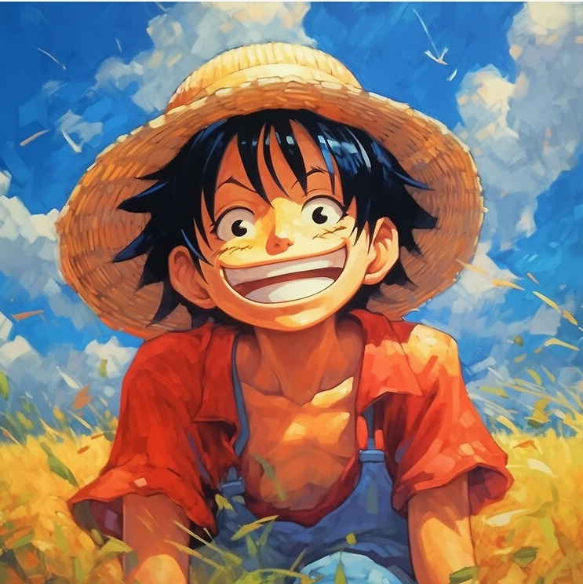

### Pop Art

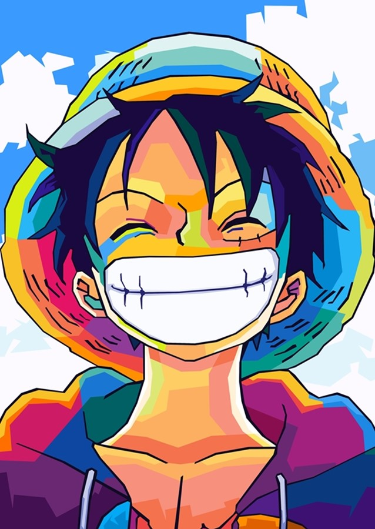

### Watercolor

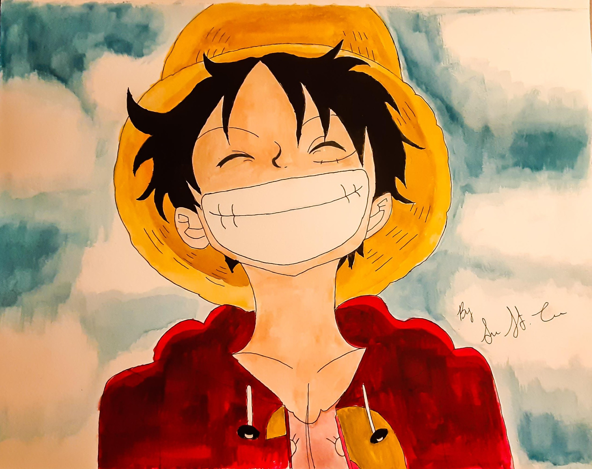

---

## Project Structure (Frontend)

```bash
vue-frontend/
├── public/
├── src/
│   ├── assets/
│   ├── components/
│   │   ├── About.vue
│   │   ├── CTA.vue
│   │   ├── Footer.vue
│   │   ├── Gallery.vue
│   │   ├── Header.vue
│   │   ├── Hero.vue
│   │   ├── ImageUpload.vue
│   │   ├── LoadingSpinner.vue
│   │   ├── ResultSection.vue
│   │   ├── StyleSelection.vue
│   ├── views/
│   │   ├── HomeView.vue
│   │   ├── GenerateView.vue
│   │   ├── GalleryView.vue
│   │   ├── AboutView.vue
│   ├── router/
│   ├── App.vue
│   └── main.js
├── package.json
└── vite.config.js
```

---

## Live Demo

The project is not deployed yet, but can be run locally using:

npm install
npm run dev

---

## Screenshots

### Home Page

The initial entry point of the application introducing the main features and guiding users into the workflow.

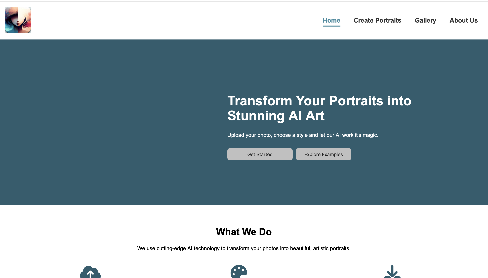

---

### About Page

Provides information about the application, its purpose, and how it works.

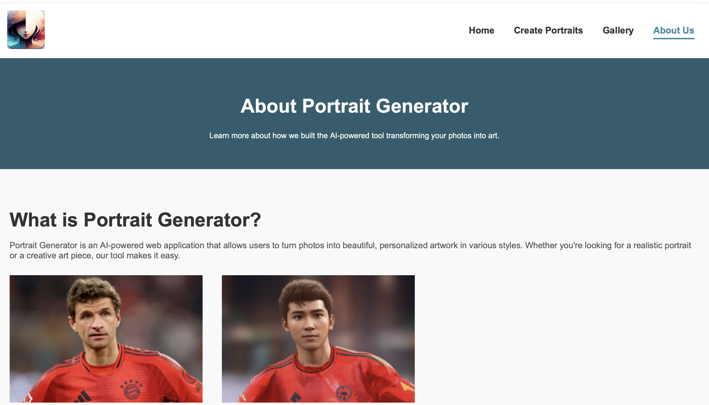

---

### Upload Page (No Image Selected)

Initial state of the upload interface before a portrait image is selected.

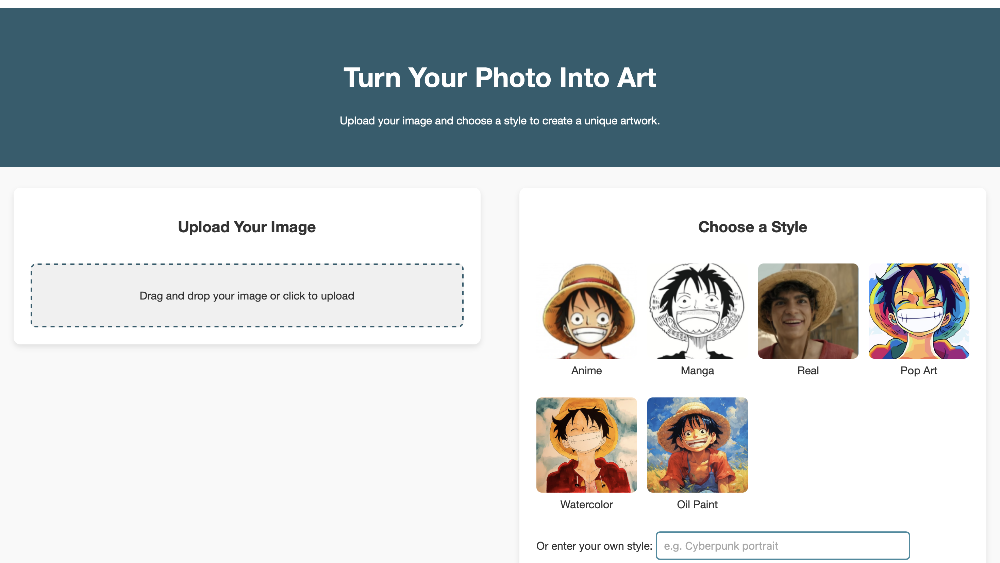

---

### Upload Page (Image Selected)

State of the upload interface after a portrait image has been uploaded.

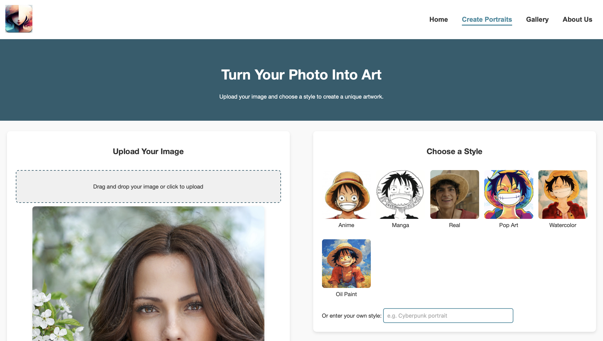

### Example Transformation (Before / After)

Example showing the transformation process within the application.

**Before**
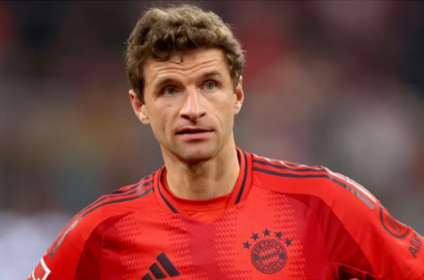

**After**
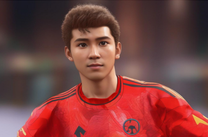

## 📌 Note

This repository contains only the frontend implementation of the AI Portrait Generator.

The image generation and AI processing are handled by a separate Python backend running on a university server and are not included here.

A backend service is required for full functionality. You will need a local or university-hosted Flask backend to generate the portraits.
